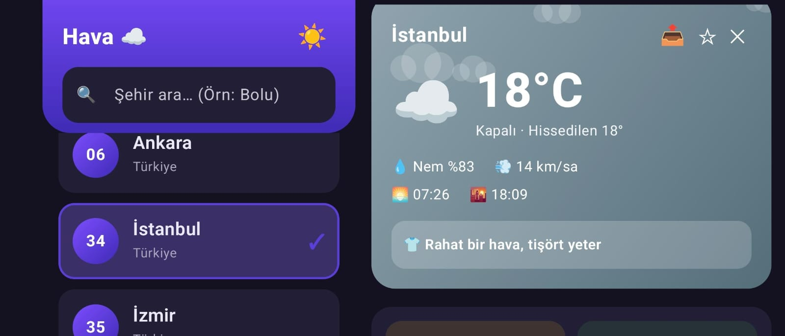
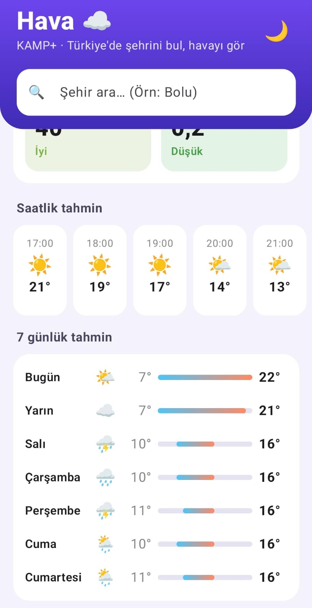
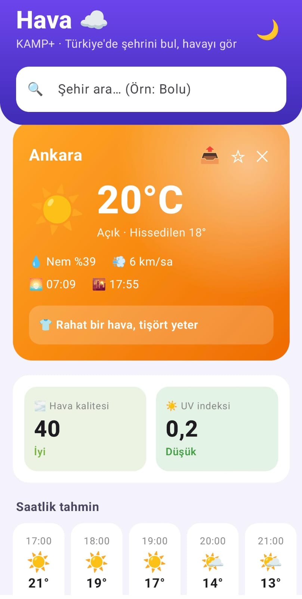
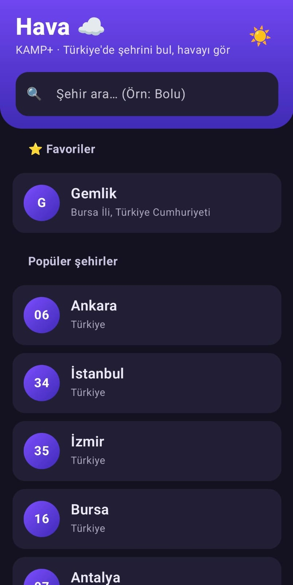

# ☁️ Hava — Türkiye Hava Durumu

Jetpack Compose ile yazılmış, Türkiye'deki şehirler için canlı hava durumu uygulaması.
**KAMP+ Bilişim Kampı** Android eğitimi kapsamında geliştirildi.

<p align="center">
  
  
  
  
</p>

## ✨ Özellikler

| | |
|---|---|
| 🔍 **Şehir arama** | Sadece Türkiye'deki yerler çıkar. Yazdıkça canlı arar (400 ms bekleme / debounce), klavyedeki "ara" tuşu da çalışır |
| 🚗 **Plaka rozeti** | 81 ilin plaka kodu; "Çankaya" aratınca rozet Ankara'nın plakasını (06) gösterir |
| 🌡️ **Anlık durum** | Sıcaklık, hissedilen, nem, rüzgâr, gün doğumu / batımı |
| ⏱️ **Saatlik ve 7 günlük tahmin** | Önümüzdeki 24 saat ve haftalık en düşük / en yüksek aralığı |
| 🌫️ **Hava kalitesi ve UV** | AQI ve UV indeksi, seviyeye göre renk ve öneri |
| 🧥 **Giyim önerisi** | "☂️ Şemsiyeni unutma", "🧥 Kalın mont şart" gibi |
| 🌧️ **Hava animasyonları** | Yağmur, kar, güneş parıltısı, yıldızlı gece, bulut, şimşek |
| ⭐ **Favoriler** | Telefonda saklanır, açılışta listenin en üstünde çıkar |
| 📴 **Çevrimdışı mod** | İnternet yokken son kaydedilen veri "Son güncelleme ..." bandıyla gösterilir |
| 🌙 **Karanlık tema** | Sistem temasını izler, ayrıca elle değiştirilebilir (tercih kaydedilir) |
| 📱 **Yatay ekran** | Yan çevirince solda liste, sağda detay (iki panel) |
| 📤 **Paylaş** | Hava durumunu WhatsApp vb. uygulamalara gönderir |
| 🧩 **Ana ekran widget'ı** | Son seçilen şehrin sıcaklığı; 30 dakikada bir ve şehir seçilince yenilenir |
| 🔁 **Dört durum** | Yükleniyor (shimmer) · Veri · Boş · Hata + "Tekrar dene" |

## 🧱 Mimari

```
UI (Composable)  →  ViewModel (StateFlow)  →  Repository (suspend)  →  Retrofit  →  Open-Meteo
```

- **UI:** durumu (`LoadState`) çizer, kullanıcı olaylarını ViewModel'e iletir.
- **ViewModel:** arama, seçili şehir, favoriler ve hava durumunu `StateFlow` ile tutar; ekran dönünce veri kaybolmaz.
- **Repository:** ağ isteklerini yapar, sütun biçimli yanıtı (`hourly.time[i]` ↔ `hourly.temperature_2m[i]`) satırlara çevirir.
- **Prefs:** `SharedPreferences` + Gson ile favoriler, son şehir, önbellek ve tema tercihi.

Kod, anlaşılır olması için `MainActivity.kt` içinde numaralı bölümlere ayrılmıştır:
Model → Data (Retrofit, Repository, Prefs) → ViewModel → Widget → Tema → Ortak parçalar → Şehir kartı → Hava detayı → Liste/Arama → Ekran → Activity.

## 🛠️ Teknoloji

Kotlin · Jetpack Compose (Material 3) · ViewModel + StateFlow · Coroutines · Retrofit 2 + Gson · App Widget (RemoteViews)

## 🌐 API

[Open-Meteo](https://open-meteo.com/) — **API anahtarı gerekmez**.

| Amaç | Adres |
|---|---|
| Şehir arama | `https://geocoding-api.open-meteo.com/v1/search?name=Bolu&countryCode=TR&language=tr` |
| Hava durumu | `https://api.open-meteo.com/v1/forecast?latitude=..&longitude=..&current=..&hourly=..&daily=..` |
| Hava kalitesi + UV | `https://air-quality-api.open-meteo.com/v1/air-quality?latitude=..&longitude=..&current=european_aqi,uv_index` |

Hava verileri [Open-Meteo.com](https://open-meteo.com/) tarafından sağlanır
([CC BY 4.0](https://creativecommons.org/licenses/by/4.0/)). Ücretsiz kullanım ticari olmayan projeler içindir.

## 🚀 Çalıştırma

1. Repoyu klonla: `git clone https://github.com/<imgesucakmak>/hava-durumu-compose.git`
2. Android Studio ile aç ve Gradle senkronizasyonunun bitmesini bekle.
3. Emülatör veya gerçek cihazda **Run ▶** de.

İnternet izni (`INTERNET`) manifest'te tanımlıdır, ekstra kurulum gerekmez.

**Widget'ı eklemek için:** ana ekranda boş bir yere uzun bas → *Widgets* → **Hava**. Önce uygulamadan bir şehir seç.

## 📁 Proje yapısı

```
app/src/main/
├── AndroidManifest.xml
├── java/com/example/meteocompose/
│   └── MainActivity.kt            Tüm uygulama kodu (bölümlere ayrılmış)
└── res/
    ├── layout/hava_widget.xml     Widget görünümü
    ├── xml/hava_widget_info.xml   Widget boyutu ve güncelleme ayarı
    └── drawable/widget_bg.xml     Widget arka planı
docs/
├── screenshots/                   README görselleri
└── SUNUM.md                       Sunum akışı ve demo senaryosu
```

## 🗺️ Yol haritası

- [ ] Unit testler (`WeatherCondition`, `CityViewModel`)
- [ ] Konumumu kullan (GPS)
- [ ] Sabah hava durumu bildirimi

## 👩‍💻 Hazırlayan

<İmge Su Çakmak> · KAMP+ Bilişim Kampı
